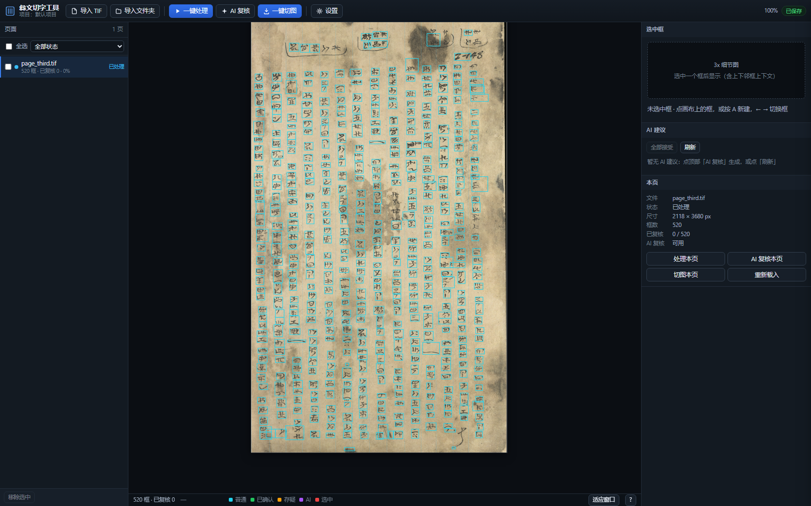
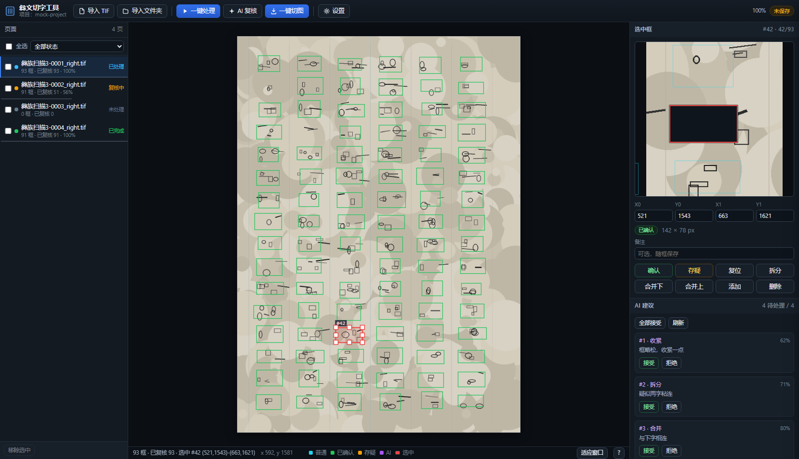
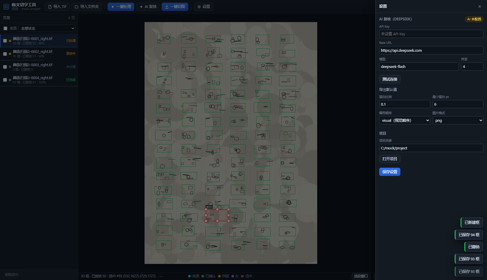
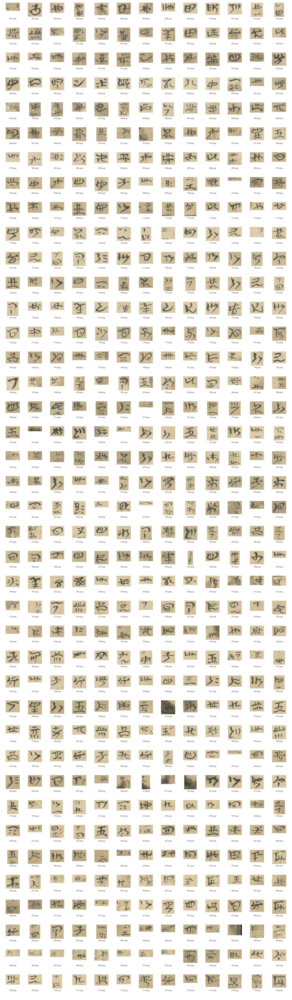

# 彝文古籍切字工具 · Yi Glyph Splitter

**把整页扫描的彝文古籍切成「一字一图」，并提供复核界面、规范字校验、字库管理与批量 CLI。**

> 中文手写彝文（诺苏文）竖排扫描件 → 一字一图的切图数据集。
> 纯 OpenCV + numpy/scipy，无 torch / 无 GPU 依赖；桌面端 FastAPI + 原生 JS + WebView2。
> 实测口径：**6 页手工框评测 mean F1 0.8768**，10 页实战切图 6024 张。

## 亮点

| | |
|---|---|
| **整页自动切字** | 光照平场 → Sauvola 二值化 → 连通域筛选 → 列带检测 → 逐列 DP 切分 → 碎片合并 → 污渍剔除 → 收紧边界；一张 6354×11042 扫描约 **7 s**（32 核，全分辨率） |
| **人工复核界面** | 拖框 / 改框 / 合并 / 切分 / 撤销；框自动编号（左→右、上→下，与导出顺序一致）；分列线可增删、可拖动；删除框不跳视角 |
| **规范字校验** | 离线字库（《规范彝文单字图形识别手册》抽取的 **1428 类 / 5716 字**）逐框打分，标出可疑框与最像的标准字形 |
| **字库管理程序** | 独立小工具 YiGlyphMgr：切图按字形聚类、人工归类 / 改名、原图分辨率重裁、批量导出 |
| **批量 CLI** | 几百页扫描无人值守跑批：tools/yi_segment.py --input scans --out out/batch --jobs 4 --resume |
| **参数可视化** | 「一键处理参数」面板实时调分割器旋钮（切分阈值、补切、污渍过滤、模板 DP…），保存即生效 |

更多界面：

| 3× 细节图 + 标准字形对照 | 一键处理参数 |
|---|---|
|  |  |

## 安装使用

### 方式 A：下载安装包（推荐）

到 [Releases](../../releases/latest) 下载 **YiGlyphSplit-1.0.0-Setup.exe**，双击安装（中文向导、免管理员，
默认装到 %LOCALAPPDATA%\\Programs\\YiGlyphSplit）。安装包约 78 MB，装完约 290 MB（自带 Python 运行时）。

### 方式 B：源码运行

~~~bash
pip install fastapi uvicorn numpy opencv-python scipy pillow pywebview pythonnet
python -m app.run --browser
~~~

### 方式 C：只要批量切图（无界面）

~~~bash
python tools/yi_segment.py --input "D:\\scans" --out out/batch --jobs 4 --resume
~~~

## 输出格式

~~~
out/<页名>/
  001.png … NNN.png    单字裁切（原纸色、不二值化；原图分辨率 + 约 10% 留白）
  index.csv            每个框的坐标：x0,y0,x1,y1,w,h,pad,gx0,gy0,gx1,gy1
  sheet.png            拼版缩略图（13 列、白底、格下编号）
  page.json            整页坐标（含列带信息）
  overlay.png          整页叠加图（质检用）
~~~

## 准确率

| 口径 | 结果 |
|---|---|
| 6 页手工框、全分辨率 | **mean F1 0.8768**（额外框 526 / 漏框 336） |
| 1/4 图控制变量消融 | 0.8465 → 0.8789（补切 + 污渍 + 收边 + 碎片）→ **0.8821**（宽/高补切参数） |
| 模板似然 DP（leave-one-page-out） | 0.8873 → 0.8902（主要收益：漏切 431 → 380） |
| 与独立形态学算法（segment_alt）交叉验证 | 匹配框 IoU 中位 0.991 |

评测脚本：scripts/bench_segmentation.py --from-out --scale 0.25；调参：scripts/tune_segmentation.py。

## 工作流程

~~~
扫描 TIF
  │ ① 光照平场 + Sauvola 二值化
  │ ② 连通域筛选（噪点 / 霉斑 / 透字）
  │ ③ 列带检测（x 投影峰 + 谷底）
  │ ④ 逐列一维 DP 切分（墨量谷 + 高度先验 + 模板似然）
  │ ⑤ 粘连补切 / 碎片合并 / 污渍过滤 / 收紧边界
  ▼
框坐标  ──► 桌面复核界面（改框 / 合并 / 切分 / 分列 / 规范字校验）
  │
  ▼
一键切图 ──► 原图分辨率裁剪 ──► 001.png + index.csv + sheet.png
~~~

## 项目结构

~~~
app/                 桌面程序（FastAPI 后端 + 原生 JS 前端 + WebView2 外壳）
glyphmgr/            独立字库管理程序（聚类 / 人工分类 / 原图重裁）
tools/yi_core/       分割算法核心（segment_v1、templatedp、export、qc、segment_alt）
tools/yi_segment.py  批量 CLI 入口
scripts/             评测、调参、字库构建、ML 聚类、原图重建等 16 个脚本
data/glyphbank/      印刷规范字库（bank.npz.b64，1428 类）
packaging/           PyInstaller spec + Inno Setup 安装包脚本
docs/                算法契约、CLI、先例调研、界面 / 后端说明、项目结束报告
samples/             界面与输出的静态样例
~~~

## 从源码打包

~~~bash
pip install pyinstaller
python packaging/make_icon.py                     # 生成图标（无切图时用占位图）
python -m PyInstaller packaging/app.spec          # onedir 程序
"%LOCALAPPDATA%\\Programs\\Inno Setup 6\\ISCC.exe" packaging\\installer.iss   # 安装包
python -m PyInstaller packaging/glyphmgr.spec     # 字库管理程序
~~~

## 文档

| 文档 | 内容 |
|---|---|
| [docs/CLI.md](docs/CLI.md) | 命令行批量切图参数与断点续跑 |
| [docs/SPEC.md](docs/SPEC.md) | 数据契约（page.json / boxes.json / index.csv） |
| [docs/APP.md](docs/APP.md) | 桌面程序使用说明 |
| [docs/APP-BACKEND.md](docs/APP-BACKEND.md) · [docs/APP-UI.md](docs/APP-UI.md) | 后端 API 与前端交互实现 |
| [docs/CALIBRATION.md](docs/CALIBRATION.md) | 分割参数与校准 |
| [docs/prior-art.md](docs/prior-art.md) | 先例调研（切字 / 版面分析 / 字形聚类） |
| [docs/PROJECT-ENDED.md](docs/PROJECT-ENDED.md) | 项目结束报告（成果清单、指标、清理与重建） |

## 数据与许可

- 原始扫描件与切图数据集**不在本仓库**（体积与版权原因），程序与算法可完整复现。
- 印刷规范字库来自《规范彝文单字图形识别手册》，仅作字形比对，随仓库以 base64 文本形式提供。
- 代码以 [MIT](LICENSE) 许可发布。

---

**English** — A complete pipeline for segmenting scanned Yi (Nuosu) manuscript pages into single-glyph
crops: illumination flattening, Sauvola binarisation, column-band detection, per-column DP cutting with
template likelihood, a FastAPI + WebView2 review UI with offline glyph-bank checking, a standalone glyph
library manager, and a batch CLI. Evaluated at **mean F1 0.8768** against hand-drawn boxes on six pages.
Archived on 2026-11-02 — see [docs/PROJECT-ENDED.md](docs/PROJECT-ENDED.md).
