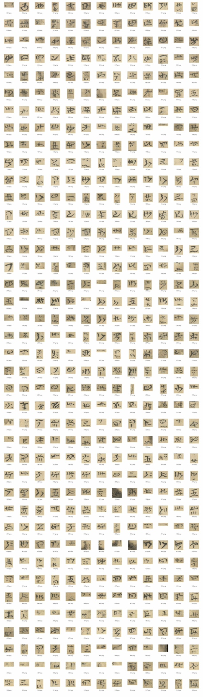

# 彝文古籍切字工具 · Yi Glyph Splitter

把一整页**彝文手抄本扫描**（竖排、自右向左、纸色不匀、霉斑 / 背面透字 / 装订黑边）自动切成
**一字一图**，并提供人工复核界面、可选的 AI 视觉复核，以及可批量跑的 CLI。

选中某个字框时右栏出现 3× 细节图（含上下邻字上下文）与逐条 AI 建议：

- 桌面程序：`distYiGlyphSplit.exe`（约 100 MB，单文件，无需装 Python）
- 实测：6354×11042 的一页 → **520 个字 / 14 列**，完整流程（分割+导出）约 30 秒
- 输出对齐给定的样式图（`docs/style/style_ref_tiles.jpg`）：原纸色矩形裁切、紧框 + 10% 留白、`001.png` 起编号（按总数补零）

## 四步流程（桌面程序）

| 步骤 | 操作 | 说明 |
|---|---|---|
| 1 导入 | 导入 TIF（多选）/ 导入文件夹 | 首次让你选一个**项目目录**存放中间数据 |
| 2 一键处理 | 选中页 → 一键处理 | 只在页面上**画框，不切图**；约 13 s/页 |
| 3 AI 复核（可选） | 设置里填 DeepSeek API Key → AI 复核 | AI 只给**建议**（紫框），逐条接受/拒绝，不直接改你的框 |
| 4 人工复核 | 拖拽 / 缩放 / 新增 / 删除 / 拆分 / 合并 / 确认 / 存疑 | 改动 400 ms 防抖自动保存；3× 细节图带上下邻字上下文 |
| 5 一键切图 | 选导出目录 | 输出 `0001.png…`、`index.csv`、`sheet.png` |

快捷键：滚轮缩放 / 空格拖动平移 · `A` 新建框 · `Del` 删除 · `S` 以鼠标 y 拆分 · `M` / `Shift+M`
与下/上一框合并 · `1`/`2`/`0` 确认/存疑/复位 · `←/→` 切换 · `Ctrl+Z` 撤销。

## 快速开始

**A. 直接用 exe**：双击 `distYiGlyphSplit.exe`（或 `YiGlyphSplit.exe --project D:ook1 --port 8765`）。
启动后自动打开浏览器（本地服务，仅 127.0.0.1）。

**B. 从源码跑界面**：

    pip install fastapi uvicorn openai numpy opencv-python scipy pillow
    python -m app.run --project D:ook1

**C. 只用命令行批量切图**（无界面，适合几百页）：

    python toolsyi_segment.py --input "D:scans" --out outatch --jobs 4 --resume

**D. 自己打包 exe**：

    powershell -ExecutionPolicy Bypass -File packaginguild.ps1

## 输出

    <项目>/exports/<页名>/
      001.png … NNN.png        单字裁切（原纸色，不二值化；位数按总数补零）
      index.csv               文件名,id,col,row,x0..y1,w,h,ink + 质量字段 flat/ink_frac/core_frac
      sheet.png               拼版缩略图（13 列、白底、格下编号）

CLI 还会额外写 `page.json`（全部坐标）与 `overlay.png`（整页叠加图）。

## 算法（纯 OpenCV，无 torch 依赖）

1. 匀光：大核 box blur 除法，压平纸色梯度（霉斑变中性灰）
2. Sauvola 二值化（窗口 ≈ 1 个字宽）
3. 连通域按 面积 / 暗度 / bbox 尺寸 过滤：去灰尘、背面透字、装订黑边、长横线框
4. **横向分块**：整行空白走廊把页面切成 block，正文与顶部批注各自独立分列
5. 列带：y 向闭运算 → x 投影**峰值 + 谷底**（污渍会让固定阈值把全页并成一列）
6. 列内 **1-D 动态规划**切字：代价 = 8·(log(h/H))² + 每刀固定费 + 切口墨量；两遍用全页 H 中位数夹逼
7. 断笔 / 点划按邻近关系并回本体
8. 后处理：只在**真空带**补切"框里还有两个字"；再用 core_frac / ink_frac 剔除霉斑假框

细节见 `docs/SPEC.md`；独立第二实现 `tools/yi_core/segment_alt.py`（纯形态学）用于交叉验证。

## 准确率（怎么核的）

- 与独立算法交叉验证：匹配框 **IoU 中位 0.991**；分歧集中在"对方把相邻两字并成一个 tall 框"
- 行距实测 ≈260–320 px、14 列 ×≈37 字 = 520 字，与原卷节奏吻合（不是过切）
- 原分辨率逐列长条图（`qc/strips/`）人眼核对：一字一框、框贴字形
- 已知残留：顶部横排批注 3–5 处连框、个别框带进邻列伸出笔画、2–3 个极淡孤立笔画成框；
  整页倾斜 >1.5° 建议先 deskew（未内置）

## AI 复核（DeepSeek 视觉）

- 接口：OpenAI 兼容 `https://api.deepseek.com`，模型 `deepseek-flash`（官方 Vision 指南）
- 每框：裁上下文（上下 0.9h、左右 0.5w）→ 在当前框上画 3px 红框 → 目标字高 ≥240 px → JPEG base64
- 提示模型**只回 JSON**（action: tighten/split/merge/keep + 归一化坐标 + 置信度），服务端换算并做
  IoU / 尺寸比 / 重叠 校验，不合格退回 keep
- 没有 Key 时自动走 mock（reason 带 `[mock]`），可离线验证界面与流程
- Key 存本机 `%LOCALAPPDATA%yi-segmentconfig.json`（明文，勿提交仓库）

## 项目结构

    app/                 桌面程序（FastAPI + 原生 JS，无框架）
      run.py             入口：起服务 + 开浏览器
      server.py store.py jobs.py pipeline.py   后端
      ai_refine.py       DeepSeek 视觉复核
      static/            index.html app.js canvas.js style.css
    tools/               算法与 CLI
      yi_core/common.py          IO / 匀光 / 二值化 / 投影
      yi_core/segment_v1.py      主算法
      yi_core/segment_alt.py     独立第二算法（交叉验证）
      yi_core/export.py          裁图 + index.csv + sheet.png
      yi_core/qc.py              质检（叠加图/分带图/缺陷统计）
      yi_segment.py              批量 CLI
    docs/                SPEC / 算法契约 / CLI / 先例调研 / 桌面使用说明 / 后端契约
    packaging/           PyInstaller spec + 构建脚本 + 图标
    scripts/e2e_app.py   端到端验收（TestClient，30 项检查）
    samples/             示例 tile / 拼版 / 界面截图

## 关于仓库里的 exe

单文件 exe（约 103 MB）不放进 git；用 `packaginguild.ps1` 一条命令重新生成（需要 Python 3.10 + 上面的依赖）。
包内已含 `tools/` 算法源码与 `app/static` 前端，运行时不读写仓库路径。

## 环境与依赖

Python 3.10；numpy / opencv-python / scipy / pillow / fastapi / uvicorn / openai。
不需要 GPU、不需要 torch、不需要联网（AI 复核除外）。

## 许可证

MIT（见 `LICENSE`）。
