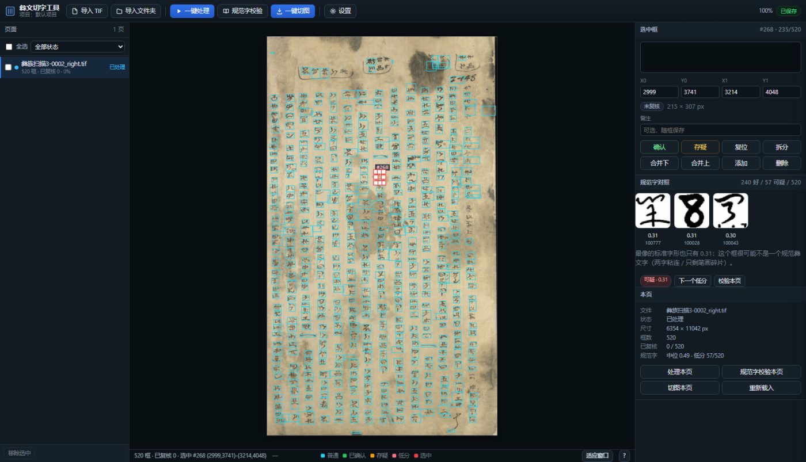

# 彝文古籍切字工具 · Yi Glyph Splitter

把一整页**彝文手抄本扫描**（竖排、自右向左、纸色不匀、霉斑 / 背面透字 / 装订黑边）自动切成
**一字一图**，并提供人工复核界面、离线的「规范字校验」（对照《规范彝文单字图形识别手册》字库打分），以及可批量跑的 CLI。

选中某个字框时，右栏会给出它的 3× 细节图（含上下邻字上下文）、规范字相似度和最像的 3 个标准字形：

颜色常驻且全为实线：**绿色=很符合规范字、红色=可疑、青色=一般**；也可以点右栏色板手动给框上色。

## 流程（桌面程序）

| 步骤 | 操作 | 说明 |
|---|---|---|
| 1 导入 | 导入 TIF（多选）/ 导入文件夹 | 首次让你选一个**项目目录**存放中间数据 |
| 2 一键处理 | 选中页 → 一键处理 | 只在页面上**画框，不切图**；约 13 s/页 |
| 3 规范字校验（离线，自动） | 无需操作：处理完一页后自动跑 | 每个框对照标准字库打分：**绿色实线=很符合规范字，红色实线=可疑**，常驻；点「下一个低分」逐个核对；约 1 s/页 |
| 4 人工复核 | 拖拽 / 缩放 / 新增 / 删除 / 拆分 / 合并 / 确认 / 存疑 | 改/新建一个框会**只重算这一框**：像规范字就恢复普通蓝框，不像就继续虚线；改动自动保存 |
| 5 一键切图 | 选导出目录 | 输出 `001.png…`、`index.csv`、`sheet.png` |

快捷键：滚轮缩放 / 空格拖动平移 · `A` 新建框 · `Del` 删除 · `S` 以鼠标 y 拆分 · `M` / `Shift+M`
与下/上一框合并 · `1`/`2`/`0` 确认/存疑/复位 · `←/→` 切换 · `Ctrl+Z` 撤销。

> 删框后画布**不会**自动跳到下一个框（只换选中态），连续删框时视角不动。

## 快速开始

**A. 直接用 exe**：双击 `distYiGlyphSplit.exe`（或 `YiGlyphSplit.exe --project D:ook1 --port 8765`）。
启动后弹出**本地窗口**（pywebview + 内嵌 WebView2，不是浏览器标签页；服务只监听 127.0.0.1）。
   想强制用系统浏览器：加 `--browser`。若机器缺 WebView2 运行时，会自动降级到 Edge 应用窗口 / 默认浏览器。

**B. 从源码跑界面**：

    pip install fastapi uvicorn openai numpy opencv-python scipy pillow pywebview pythonnet
    python -m app.run --project D:ook1

**C. 只用命令行批量切图**（无界面，适合几百页）：

    python toolsyi_segment.py --input "D:scans" --out outatch --jobs 4 --resume

**D. 自己打包 exe**：

    powershell -ExecutionPolicy Bypass -File packaginguild.ps1

## 输出

    <项目>/exports/<页名>/
      001.png … NNN.png        单字裁切（原纸色，不二值化；位数按总数补零）
      index.csv               文件名,id,col,row,x0..y1,w,h,ink + 质量字段 flat/ink_frac/core_frac
      sheet.png               拼版缩略图（13 列、白底、格下编号）

CLI 还会额外写 `page.json`（全部坐标）与 `overlay.png`（整页叠加图）。

## 算法（纯 OpenCV，无 torch 依赖）

1. 匀光：大核 box blur 除法，压平纸色梯度（霉斑变中性灰）
2. Sauvola 二值化（窗口 ≈ 1 个字宽）
3. 连通域按 面积 / 暗度 / bbox 尺寸 过滤：去灰尘、背面透字、装订黑边、长横线框
4. **横向分块**：整行空白走廊把页面切成 block，正文与顶部批注各自独立分列
5. 列带：y 向闭运算 → x 投影**峰值 + 谷底**（污渍会让固定阈值把全页并成一列）
6. 列内 **1-D 动态规划**切字：代价 = 8·(log(h/H))² + 每刀固定费 + 切口墨量；两遍用全页 H 中位数夹逼
7. 断笔 / 点划按邻近关系并回本体
8. 后处理：只在**真空带**补切"框里还有两个字"；再用 core_frac / ink_frac 剔除霉斑假框

细节见 `docs/SPEC.md`；独立第二实现 `tools/yi_core/segment_alt.py`（纯形态学）用于交叉验证。

## 准确率（怎么核的）

- 与独立算法交叉验证：匹配框 **IoU 中位 0.991**；分歧集中在"对方把相邻两字并成一个 tall 框"
- 行距实测 ≈260–320 px、14 列 ×≈37 字 = 520 字，与原卷节奏吻合（不是过切）
- 原分辨率逐列长条图（`qc/strips/`）人眼核对：一字一框、框贴字形
- 已知残留：顶部横排批注 3–5 处连框、个别框带进邻列伸出笔画、2–3 个极淡孤立笔画成框；
  整页倾斜 >1.5° 建议先 deskew（未内置）

## 规范字校验（离线字库，替代原来的 AI 复核）

字库来自 **《规范彝文单字图形识别手册》**（129 页目录式 PDF）：抽出 **1428 个类别、5716 张标准字形**，
归一化成 48×48 的墨迹图，打包成 `data/glyphbank/bank.npz`（约 6 MB，随 exe 一起分发）。

对每个框：裁出墨迹 → 居中缩放到 48×48 → 与 5716 张标准字形算余弦相似度（16×16 粗筛 + 48×48 精选）。

| 分数 | 含义 | 界面 |
|---|---|---|
| ≥ 0.50 | 与某个规范字明显吻合 | 青色实线框 |
| 0.40–0.50 | 部分吻合 | 青色实线框（提示「一般」） |
| ≥ 0.62 | 与某个规范字高度吻合 | **绿色实线框** |
| < 0.38 | **很可能不是一个规范彝文字** | **红色实线框** + 「下一个低分」按钮逐个核对 |

实测本页 520 框：中位 0.49、240 框 ≥0.50、57 框低分——低分框目视核对，基本就是「两字粘连」「只剩笔画碎片」
或页面边角的霉斑残留，正是你不认识彝文时最需要被点名的地方。右栏同时给出**最像的 3 个标准字形**（带类别编号），
可以拿它对照：像不像一个字、像哪个字。

> 这一步完全离线、可复现、不花钱；每页约 1 秒（520 框）。重建字库：`python scripts/build_glyphbank.py --pdf <手册.pdf>`。

## 项目结构

    app/                 桌面程序（FastAPI + 原生 JS，无框架）
      run.py             入口：起服务 + 原生桌面窗口（WebView2）
      server.py store.py jobs.py pipeline.py   后端
      yi_ref.py          规范字库匹配（离线打分）
      static/            index.html app.js canvas.js style.css
    tools/               算法与 CLI
      yi_core/common.py          IO / 匀光 / 二值化 / 投影
      yi_core/segment_v1.py      主算法
      yi_core/segment_alt.py     独立第二算法（交叉验证）
      yi_core/export.py          裁图 + index.csv + sheet.png
      yi_core/qc.py              质检（叠加图/分带图/缺陷统计）
      yi_segment.py              批量 CLI
    docs/                SPEC / 算法契约 / CLI / 先例调研 / 桌面使用说明 / 后端契约
    packaging/           PyInstaller spec + 构建脚本 + 图标
    scripts/e2e_app.py   端到端验收（TestClient，30 项检查）
    data/glyphbank/      规范字库（bank.npz 或文本版 bank.npz.b64）
    samples/             示例 tile / 拼版 / 界面截图

## 关于仓库里的 exe

单文件 exe（约 103 MB）不放进 git；用 `packaginguild.ps1` 一条命令重新生成（需要 Python 3.10 + 上面的依赖）。
包内已含 `tools/` 算法源码与 `app/static` 前端，运行时不读写仓库路径。

## 环境与依赖

Python 3.10；numpy / opencv-python / scipy / pillow / fastapi / uvicorn /
pywebview(+pythonnet, 原生窗口)。不需要 GPU、不需要 torch、不需要联网。

## 常见问题

**打包后的 exe 一启动就弹 “Unhandled exception in script / Unable to configure formatter 'default'”**
窗口模式（`--noconsole`）下 `sys.stdout/stderr` 是 `None`，而 uvicorn 默认日志配置要写 `sys.stderr`。
本仓库 `app/run.py` 已修：启动时把空流重定向到 devnull，并给 uvicorn 传 `log_config=None`（日志自己写到
`%LOCALAPPDATA%yi-segmentlogsapp.log`）。若你改过入口文件，注意别把这两处改回去。

**画布一片空白、右栏显示「尺寸 0 × 0」**：多半是这一页的预览图缺失或写坏了（处理到一半被取消/进程被杀）。
现在会自动修复：服务端在打开页面或请求预览时发现缺失/损坏就当场重建，前端失败一次还会带 `?rebuild=1` 重试；
也可以手动点右栏「重新载入」。若仍空白，看日志 `%LOCALAPPDATA%\yi-segment\logs\app.log`。

**规范字校验很多低分怎么办**：低分只代表「不像标准字形」，不一定是错——手写体的连笔、残墨、边界字都会低分。
点「下一个低分」逐个看右栏那 3 个标准字形：明显是两个字粘连就按 `S` 拆开，明显是碎片就 `Del` 删掉。
如果整页普遍低分，多半是扫描倾斜或字迹过淡，先做预处理。

**双击没反应 / 端口被占用**：程序会自动顺延端口（8765→8766…）并打印在日志里；也可以在快捷方式后加
`--port 9000`。**SmartScreen 拦截**：exe 未签名，选「更多信息 → 仍要运行」。

## 许可证

MIT（见 `LICENSE`）。
